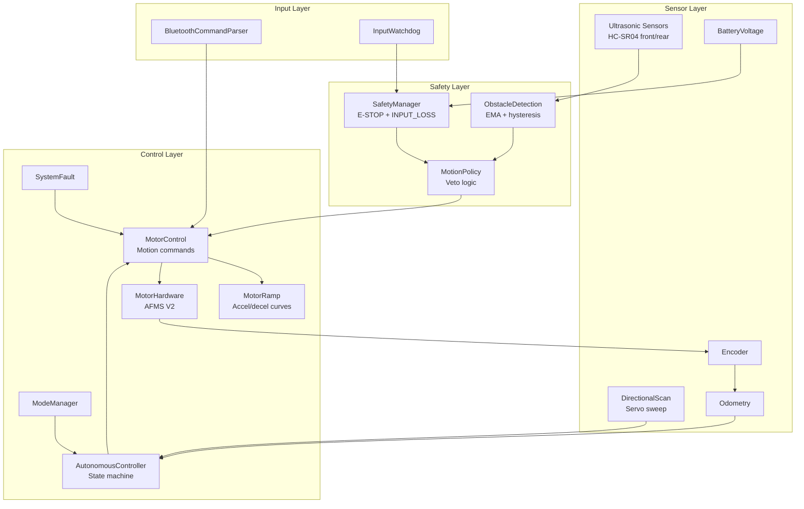
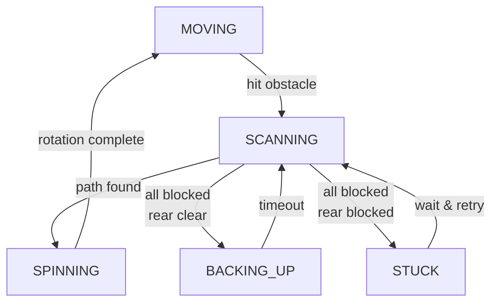

# Project MecanumCar Architecture

## Overview

Bluetooth-controlled Mecanum wheel robot with autonomous obstacle avoidance. The robot uses an Arduino Uno and an Adafruit Motor Shield V2 (TB6612FNG motor driver and PCA9685 PWM controller). The firmware uses modular C++ on the Arduino Framework. The robot has dual HC-SR04 ultrasonic sensors with a servo turret and a real-time safety subsystem.

## Why This Project Exists

This project is a complete rewrite of the ZYC0044 Mini Mecanum Wheel Car kit firmware.

### The Original Kit

The original kit has severe limitations for real-world use.
- The code uses blocking delays, which freeze the car during maneuvers.
- The code uses a flat structure with global variables. It has no modularity.
- The kit has no safety system. It has no watchdog, input loss detection, or emergency stop.
- The obstacle logic is minimal. It uses one sensor, no hysteresis, and a fixed 20 cm threshold.
- The kit has no autonomous navigation. It only backs up and turns left.
- The motors start and stop instantly. The kit has no motor ramping.
- The code is hardcoded for the Arduino Uno R3 and has no support for the R4.
- Speeds, distances, and pin assignments are not configurable.

### The Rewrite

This firmware rebuilds the kit from the ground up.
- **Modular C++ architecture:** Separate modules for communication, control, input, safety, and sensors.
- **Non-blocking scheduling:** All scheduling uses `millis()`. A two-sensor loop costs about 60 ms. No `delay()` function freezes the loop.
- **Real-time safety:** A watchdog, input loss detection, and a latching emergency stop.
- **Autonomous navigation:** A state machine with pathfinding (MOVING -> SCANNING -> SPINNING -> BACKING_UP -> STUCK).
- **Dual ultrasonic sensors:** A front sensor (servo-mounted, 5-position sweep) and a rear sensor.
- **Sensor filtering:** Exponential moving average (EMA) and hysteresis for stable readings.
- **Motor ramping:** Smooth acceleration and deceleration (400 ms up, 200 ms down).
- **Dual-board support:** Works on Arduino Uno R3 and R4 Minima/WiFi.
- **Fully configurable:** All settings are in `Config.h`, `HardwareConfig.h`, and `LogConfig.h`.
- **Real feedback:** Speed gauge, step mode, and debug output.

## Firmware Architecture

### Module Organization

**Comms** (`src/comms/`)
- `Comms`: Serial output multiplexing (debug mirror and Bluetooth feedback). Supports HC-05 (STATE pin optional) and HC-06 modules.
- `MultiPrint`: Sends output to two channels simultaneously.

**Log** (`src/log/`)
- `Log`: Two-mask runtime logging (level and channel). Uses `LOG_D/I/W/E` macros.
- `LogConfig.h`: Compile-time gate (`LOG_ENABLED`).

**Control** (`src/control/`)
- `MotorHardware`: Singleton hardware ownership of motors. Provides a raw PWM interface to the AFMS V2.
- `MotorControl`: Applies motion commands to motors via MotorHardware.
- `MotorRamp`: Acceleration and deceleration curves (400 ms accel, 200 ms decel).
- `MotorPID`: Closed-loop PID speed control. Uses per-wheel gains. Defaults to 0.0 (open loop).
- `ModeManager`: Manual vs. Autonomous mode switching.
- `AutonomousController`: Autonomous state machine (MOVING -> SCANNING -> SPINNING -> BACKING_UP -> STUCK).
- `MotionCommand`: Data structure for motion intents (speed, direction).

**Input** (`src/input/`)
- `BluetoothCommandParser`: Parses ASCII commands from the Bluetooth module.
- `BluetoothButtonInput`: Maps button commands (W/A/S/D/Q/E/Z/C/J/L) to motion intents.
- `BluetoothSpeedAuthority`: Handles speed step control (%+, %-, %R/%N/%F).
- `BluetoothSystemCommands`: Handles system commands (!, ?, 0, 1, T, P).
- `InputWatchdog`: Bluetooth keepalive. Asserts INPUT_LOSS (150 ms timeout).

**Safety** (`src/safety/`)
- `SystemFault`: Fault state tracking and latching. SENSOR_FAIL clears with `?`. Prints the active fault reason when a new fault occurs.
- `ObstacleDetection`: Sensor thresholds with hysteresis. Returns a `Proximity` struct (`in_slow_zone`, `in_stop_zone`, `distance_cm`). The distance is EMA-filtered. Zone flags use raw readings.
- `SafetyManager`: System fault aggregation (emergency stop, input loss).
- `MotionPolicy`: Decision logic for motion vetoes. Applies emergency stop and input loss overrides. Applies obstacle detection scaling (0.5x in slow zone). Clamps the forward axis in stop zones to allow strafe and rotate escape maneuvers.

**Sensors** (`src/sensors/`)
- `Odometry`: Converts encoder ticks to physical position (x, y, heading) using mecanum kinematics.
- `Encoder`: Reads H206 sensors. Uses AGTimer polling at 4 kHz on R4 and PCINT2 on R3.
- `Ultrasonic`: HC-SR04 wrapper with EMA-filtered readings. Dropout handling (`dist==0` treated as 999 cm).
- `DirectionalScan`: Servo sweep logic. Sweeps 5 positions.
- `BatteryVoltage`: 0-25V voltage sensor reader. Tracks minimum voltage seen for critical E-stop.

**Main Loop** (`src/main.cpp`)
1. `BluetoothCommandParser::handle()` — Receive and dispatch commands
2. `input_watchdog.update()` — Check for signal loss (only when moving)
3. `BluetoothSpeedAuthority::feedback_tick()` — Send periodic speed telemetry
4. HC-05 connection status check — Detect physical disconnection
5. `ObstacleDetection::update()` — Poll ultrasonic sensors, apply hysteresis
6. `SafetyManager::update()` — Aggregate faults (E-STOP, INPUT_LOSS, etc.)
7. `BatteryVoltage::report()` — Send voltage telemetry (every 2s)
8. `AutonomousController::update()` — Execute autonomous state machine
9. `MotorRamp::update()` — Apply ramping curves
10. `MotorControl::update()` — Write PWM to motors
11. `Odometry::update()` — Integrate encoder ticks into position

### Flowchart

## Autonomous State Machine

**MOVING**
- Drives forward at `AUTO_SPEED` (600 per-mille = 60%).
- Monitors front/rear obstacles.
- Transitions to SCANNING on obstacle detection.

**SCANNING**
- Stops at the obstacle.
- The servo sweeps 5 positions via `DirectionalScan::start_sweep()`.
- Evaluates the `SweepResult`.
- Transitions to SPINNING, rotating toward the clearest direction.
- If all paths are blocked, checks the rear distance against `REAR_STOP_EXIT_CM` to trigger `BACKING_UP`.
- Triggers `SENSOR_FAIL` if the sweep exceeds `AUTO_SWEEP_TIMEOUT_MS`.

**SPINNING**
- Rotates toward the clearest direction.
- Uses encoder tick targets if `ENABLE_ENCODERS` is 1.
- Falls back to `AUTO_SPIN_DIAGONAL_MS` (500 ms, 45°) or `AUTO_SPIN_SIDE_MS` (1000 ms, 90°) if encoders are disabled.
- Caps spin speed at `AUTO_SPIN_SPEED` (400 per-mille).
- Transitions to MOVING after rotation.

**BACKING_UP**
- Reverses at reduced speed (`AUTO_REVERSE_SPEED`).
- Reverses for `AUTO_BACKUP_MS` or until the rear is blocked.
- Transitions back to SCANNING.

**STUCK**
- All directions are blocked.
- Waits `AUTO_RETRY_WAIT_MS` (2000 ms).
- Retries by transitioning back to SCANNING.
- If retries are exhausted, stops and waits for user intervention.

### Navigation Logic Flow

## Control Protocol

### Command Format

Single-character ASCII commands. Commands can be sent one at a time or batched.

**Movement**
- `W`, `S`, `A`, `D`: Forward, Backward, Strafe Left, Strafe Right.
- `Q`, `E`, `Z`, `C`: Diagonals.
- `J`, `L`: Spin left (CCW), Spin right (CW).
- `X`: Soft stop (non-latching). Also used as idle heartbeat.

**Speed Control**
- `%+`, `%-`: Increase or decrease speed.
- `%R`, `%N`, `%F`: Rough (10%), Normal (5%), Fine (1%) step modes.

**System**
- `!`: Emergency stop (latching).
- `?`: Reset / clear emergency stop and SENSOR_FAIL.
- `1`, `0`: Autonomous mode ON/OFF.
- `T`: Toggle arc turn mode.
- `P`: Toggle closed-loop PID.

### Feedback (Robot -> App)

- `*G[value]*`: Speed gauge (0 to 1000).
- `*%[mode]*`: Step mode (Fine, Normal, Rough).
- `*V[value]V*`: Filtered battery voltage.
- `*M[value]V*`: Minimum battery voltage.

### Watchdog Behavior

- Armed only while moving.
- Timeout: 150 ms (`INPUT_WATCHDOG_TIMEOUT_MS`).
- Action: Asserts INPUT_LOSS. MotionPolicy blocks motion.
- Recovery: Any valid command clears INPUT_LOSS.

## Safety Subsystem

### Safety States

| Priority | State | Trigger | Recovery |
|---|---|---|---|
| 1 | EMERGENCY_STOP | `!` command, battery critical, hardware fault | Manual reset (`?`) |
| 2 | CONNECTION_LOSS | HC-05 STATE pin LOW | Re-pair/reconnect |
| 3 | INPUT_LOSS | Watchdog timeout while moving | Auto-resume on command |
| 4 | CLEAR | Normal operation | — |

### Obstacle Detection

**Thresholds**
| Zone | Front | Rear | Action |
|---|---|---|---|
| Clear | >35 cm | >40 cm | Full speed |
| Slow | 30 to 35 cm | 35 to 40 cm | Scale to 0.5x speed |
| Stop | 15 to 20 cm | 15 to 20 cm | Clamp forward motion |

**Hysteresis**
- Front slow: 30 cm entry, 35 cm exit.
- Front stop: 15 cm entry, 20 cm exit.
- Rear slow: 35 cm entry, 40 cm exit.
- Rear stop: 15 cm entry, 20 cm exit.

**EMA Filtering**
- Alpha = 0.35.
- Applied to telemetry only. Zone flags use raw readings.

## Configuration

**Config files:** `include/config/` contains three files.

- `HardwareConfig.h`: Physical hardware presence.
- `Config.h`: Software behavior.
- `LogConfig.h`: Compile-time log gate.

### Hardware Pins

- **Servo:** D10.
- **Front Ultrasonic:** TRIG D11, ECHO D12.
- **Rear Ultrasonic:** TRIG D8, ECHO D9.
- **Bluetooth:** D0/D1.
- **Bluetooth STATE:** D2.
- **Battery Monitor:** A0.
- **Encoders:** D7 (FL), D6 (FR), D5 (RL), D4 (RR).

### Feature Flags

**Software Features** (`Config.h`)
- `ENABLE_INPUT_WATCHDOG` = 1
- `ENABLE_INPUT_BUTTONS` = 1
- `ENABLE_INPUT_SPEED_AUTHORITY` = 1
- `ENABLE_DIRECTIONAL_SCAN` = 1
- `ENABLE_OBSTACLE_AVOIDANCE` = 1
- `ENABLE_AUTONOMOUS_MODE` = 0

**Hardware Presence** (`HardwareConfig.h`)
- `ENABLE_HC05_STATE_PIN` = 0
- `ENABLE_ULTRASONIC_FRONT` = 1
- `ENABLE_ULTRASONIC_REAR` = 1
- `ENABLE_SERVO` = 1
- `ENABLE_BATTERY_MONITOR` = 0
- `ENABLE_ENCODERS` = 0

### Kinematics

- `WHEEL_DIAMETER_MM`: Physical wheel diameter.
- `TRACK_WIDTH_MM`: Distance between wheel centers.

### Drive Behavior

- **Speed:** MIN (200), MAX (1000), DEFAULT (1000) per-mille.
- **Speed steps:** ROUGH (10%), NORMAL (5%), FINE (1%).
- **Motor ramp:** UP (400 ms), DOWN (200 ms).

### Autonomous Mode

- `AUTO_SPEED = 600`
- `AUTO_REVERSE_SPEED = 300`
- `AUTO_SPIN_SPEED = 400`
- `AUTO_RETRY_WAIT_MS = 2000`
- `AUTO_SWEEP_TIMEOUT_MS = 3000`
- `AUTO_SPIN_DIAGONAL_MS = 500`
- `AUTO_SPIN_SIDE_MS = 1000`

## Design Patterns

### Non-Blocking Architecture

- No `delay()` in the codebase.
- All scheduling uses `millis()`.
- Sensor reads are polled on demand.

### Hardware Ownership

- `MotorHardware` owns the Motor Shield.
- `DirectionalScan` owns the servo.
- `Sensors` owns the HC-SR04 instances.
- Other modules receive references or pointers.

### Code Layout Standard

Enforced via `docs/Code_Layout_Standard.md`.

- `.h` files contain public API only.
- `.cpp` files contain implementation and internal state.
- One module per file.
- Namespaces are always used.
- Full qualification for cross-module calls.

## Performance

| Metric | Value |
|---|---|
| Command latency | <10 ms |
| Motor response | <50 ms |
| Ultrasonic sampling | ~50 ms per sensor |
| Servo sweep | ~1.2 seconds |
| Speed ramp | 400 ms accel, 200 ms decel |
| Watchdog timeout | 150 ms |
| PWM resolution | 12-bit (0–4095) |
